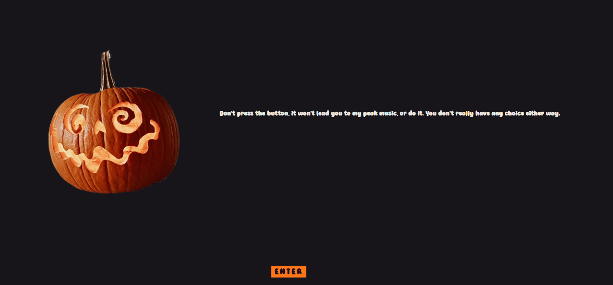
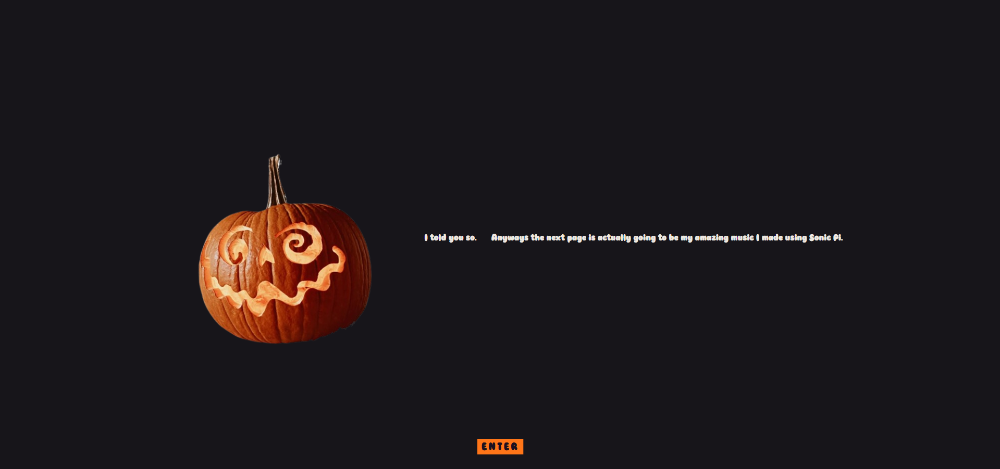

# Goodnight, Lover

## What It Is

A website to showcase my amazing song, my first ever Sonic Pi song :3 With an interesting way to get to the song. 

## Why I Made It

When I learnt about Sonic Pi, I thought I was going to be the next Hatsune Miku T-T Just thought it was so cool on how much we can do with coding nowadays. Though, setting it up took me years because I required a different version T-T I kinda wanted to make a song with my own voice but listening to my raw vocals made me think otherwise.

## How I Made It

Tech Stack:

- Sonic Pi
- HTML
- CSS
- JS

Sonic Pi at first was genuinely so hard for me but when I heard my own sample after just adding Piano, I started feeling myself and adding more and more. The website is rather simple though, I didn't know how to put an audio like it appears on VS Code, so had to do a lot of google searching on neocities to figure out a two line code.

## What I Struggled With and What I Learnt

Coding is awesome when you find fun things to make. And also struggled with the jumpscare's audio part for a while (always the audio) but somehow made it work so all's well, and you're reading this. Also the code display part was a gold find from this one random neocities html teaching website. Additionaly, copy and pasting the HTML code for the different pages saved me a lot of time.

## Screenshots

